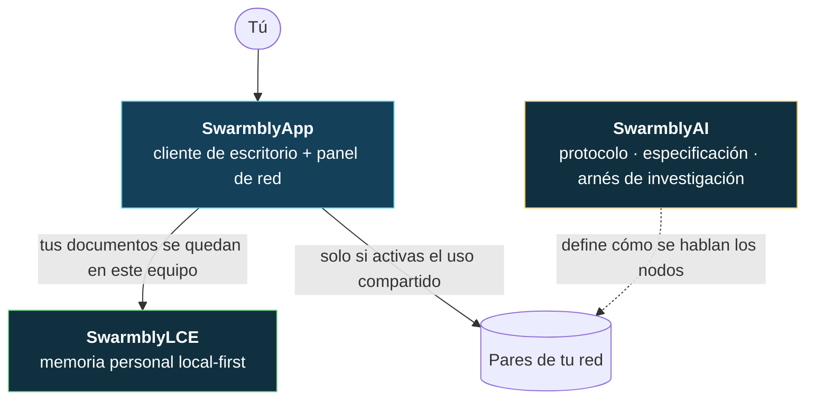
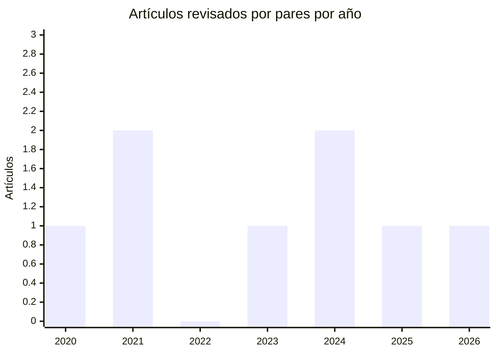
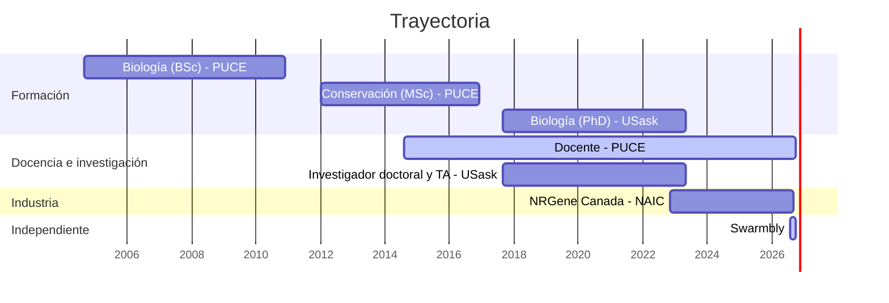

🇪🇸 **Español** · 🌐 [Read in English](README.md)

    

## Hola, soy Seb 👋

Soy **biólogo y especialista en genómica** (PhD, Universidad de Saskatchewan) y vivo en Saskatoon, Canadá. Llevo más de 18 años leyendo genomas — de los sinsontes de Galápagos a las moscas soldado negra — y ahora uso lo que la genómica me enseñó para construir otra clase de IA: una que **divide el problema, no el modelo**.

| Resumen | Detalle |
| --- | --- |
| 🧬 Qué hago | Genómica de poblaciones y de la conservación · mejoramiento genético · bioinformática |
| 🤖 Qué construyo | [**Swarmbly**](#swarmbly) — inferencia descentralizada con modelos pequeños, inspirada en el ensamblaje de genomas |
| 🎓 Docencia | Docente Universitario (Profesor Adjunto), PUCE — desde 2014 |
| 🧪 Recientemente | Gerente de I+D e Investigador Principal, North American Insect Center de NRGene Canada (hasta sep. 2026) |
| 🗣️ Idiomas | Español (nativo) · Inglés (profesional completo) |
| 📍 Vivo en | Saskatoon, Saskatchewan, Canadá |

**Cómo moverte por aquí**

| Si eres… | Empieza por | Encontrarás |
| --- | --- | --- |
| 🔬 Investigador/a | [Ciencia](#ciencia) · [Swarmbly](#swarmbly) | 8 artículos, preprints y DOI |
| 💻 Desarrollador/a | [Swarmbly](#swarmbly) · [Innovaciones](#innovaciones) | Repos de Swarmbly (AGPL-3.0), herramientas de investigación, estado honesto |
| 🧭 Reclutador/a o colaborador/a | [Experiencia](#experiencia) · [Herramientas](#herramientas) | Trayectoria, habilidades, liderazgo |
| ☕ Quieres apoyar | [Apoyo](#apoyo) | En qué se usa tu apoyo |

> [!IMPORTANT]
> **Swarmbly es software de investigación en fase alfa.** Sus artículos son preprints y **no** han pasado por revisión por pares. Publico lo que funciona *y* lo que no: los resultados negativos están a la vista.

## Swarmbly

**Dividir el *problema*, no el *modelo*.**

La mayoría de la IA descentralizada parte un **modelo** entre varias máquinas, y todo espera a la más lenta. Swarmbly parte la **solicitud**: un modelo pequeño local divide una tarea estructurada en microtareas, computadoras comunes las resuelven en paralelo con modelos pequeños y las respuestas se reensamblan en tu propia máquina, igual que se ensambla un genoma a partir de lecturas de secuenciación.

| Paso | Qué ocurre | Por qué importa |
| --- | --- | --- |
| ① Fragmentar | Un modelo pequeño local divide la solicitud en microtareas autocontenidas (solo si la tarea tiene una estructura real; la prosa libre se queda en local) | Ninguna máquina necesita un modelo grande |
| ② Despachar | Las microtareas salen **en paralelo** hacia computadoras autenticadas de tu red | Un nodo lento no bloquea al resto |
| ③ Replicar | Las réplicas van a *familias de modelos distintas* y se comprueban (firmas, esquema) | Redundancia frente a respuestas malas o ausentes |
| ④ Ensamblar | Tu máquina alinea las respuestas, vota por consenso y empalma la respuesta final | Tus documentos y la solicitud completa no tienen que salir |

🧬 <b>Haz clic para abrir:</b> cómo se corresponden el ensamblaje de genomas y Swarmbly

| Ensamblaje shotgun de genomas | Swarmbly | Idea |
| --- | --- | --- |
| Lecturas (*reads*) | Microprompts | Piezas cortas que se resuelven por separado |
| Cobertura | Replicación en *k* familias de modelos | Varias miradas independientes a la misma pieza |
| Solapamiento | Costuras entre fragmentos | Los bordes compartidos dicen cómo encajan las piezas |
| Consenso | Voto por alineamiento múltiple | Los desacuerdos se resuelven por mayoría, no por esperanza |
| Contigs → andamio | Respuesta final empalmada | Las piezas se vuelven un todo coherente |

### Cómo encajan los tres repos

| Repo | Qué es | Estado | Cita |
| --- | --- | --- | --- |
| [**SwarmblyAI**](https://github.com/Sebastardito/SwarmblyAI) | Protocolo, especificación y arnés de medición (Python, AGPL-3.0-or-later) | Código de investigación · publicación defensiva | [10.5281/zenodo.21956743](https://doi.org/10.5281/zenodo.21956743) |
| [**SwarmblyLCE**](https://github.com/Sebastardito/SwarmblyLCE) | Extensión Cognitiva Local: memoria personal que se queda en tu máquina (especificación en borrador, 109 pruebas, CLI) | Borrador · sin revisión por pares | [10.5281/zenodo.23289041](https://doi.org/10.5281/zenodo.23289041) |
| [**SwarmblyApp**](https://github.com/Sebastardito/SwarmblyApp) | Cliente de escritorio y panel de red: chat local, enjambres en LAN, «Explorar procesamiento» | Alfa | [10.5281/zenodo.23322639](https://doi.org/10.5281/zenodo.23322639) |

📄 Whitepaper: [*Semantic Fragmentation and Stochastic Assembly*](https://doi.org/10.5281/zenodo.23031305) (v2, EN/ES, CC BY 4.0) · Whitepaper de LCE: [10.5281/zenodo.23150478](https://doi.org/10.5281/zenodo.23150478)

### Estado honesto

| ✅ Funciona hoy | 🚧 Todavía no |
| --- | --- |
| Chat local con Ollama o cualquier servidor compatible con OpenAI | Enjambres por internet (punto de encuentro, NAT) |
| Los equipos de una misma red se encuentran sin escribir direcciones (mDNS) | Verificación completa de resultados (hoy es parcial) |
| Identidades de nodo firmadas (Ed25519) ligadas a TLS 1.3 | Umbrales calibrados de costuras y consenso |
| Solicitudes estructuradas fragmentadas y despachadas en paralelo | Mediciones a gran escala con modelos reales |
| Consenso multimodelo — reportado como *acuerdo*, nunca como prueba de exactitud | Revisión por pares |
| «Explorar procesamiento»: cada respuesta muestra sus 14 etapas; cada cifra se marca como *medida*, *estimada* o *desconocida* | Fragmentar prosa libre (se responde en local, por diseño) |

### Resultados hasta ahora — también los negativos

| Pregunta | Qué encontré | Dónde |
| --- | --- | --- |
| ¿Fragmentar y reensamblar un prompt cuesta calidad? | Resultado mixto: mejor que una sola pasada en algunas categorías de tareas, con un costo de coherencia medible. No afirmo que sea más rápido que las API centralizadas. | SwarmblyAI |
| ¿El acuerdo entre réplicas predice la calidad? | No hay relación medible → **degradé esa parte del diseño.** | SwarmblyAI |
| ¿La memoria local mejora las respuestas sobre mis propios documentos? | Sí: +0,500 (exploratorio). | SwarmblyLCE |
| ¿Una wiki digerida supera a la recuperación directa sobre las fuentes? | No: −0,146 (confirmatorio) → la wiki pasa a ser capa de gobierno, no la memoria que responde. | SwarmblyLCE |

🗺️ <b>Haz clic para abrir:</b> hacia dónde va Swarmbly (hitos, sin fechas)

Los hitos son metas, no promesas; cada uno debe pasar mediciones que defino *antes* de correrlas.

## Innovaciones

Un recorrido rápido por lo nuevo de mi trabajo, del laboratorio al enjambre.

| Innovación | Qué tiene de nuevo | Dónde verla |
| --- | --- | --- |
| 🧩 Inferencia por fragmentación del problema | Divide la *solicitud* en vez del modelo, con la lógica del ensamblaje shotgun de la genómica | [SwarmblyAI](https://github.com/Sebastardito/SwarmblyAI) |
| 🧠 Extensión cognitiva local-first | Memoria personal con olvido verificable; la wiki es una capa de gobierno y la recuperación corre sobre tus propias fuentes | [SwarmblyLCE](https://github.com/Sebastardito/SwarmblyLCE) |
| 🔍 Respuestas que muestran cómo se hicieron | «Explorar procesamiento»: 14 etapas, cada intento y el nodo que lo atendió, con etiquetas *medido / estimado / desconocido* | [SwarmblyApp](https://github.com/Sebastardito/SwarmblyApp) |
| 📏 Investigación en IA falsable | Experimentos preregistrados, criterios de abandono explícitos y resultados negativos publicados junto a los positivos | [Resultados](#resultados-hasta-ahora--también-los-negativos) |
| 🪰 Tecnología de mejoramiento | Aplicaciones de fenotipado (LarvaeTracker, Image Analyzer) y herramientas de genotipo–fenotipo/GWAS que redujeron hasta un 80 % el tiempo de tareas clave | [LarvaeTracker](https://github.com/Sebastardito/LarvaeTracker) · [Experiencia](#experiencia) |
| 🍎 LLM en el dispositivo | Más de 20 LLM a medida afinados con Unsloth y MLX, optimizados para inferencia en Apple Silicon | [Herramientas](#herramientas) |

### Más herramientas de código abierto

Proyectos más pequeños del laboratorio y del campo, todos públicos en mi GitHub.

| Repo | Qué hace | Tecnología |
| --- | --- | --- |
| [**LarvaeTracker**](https://github.com/Sebastardito/LarvaeTracker) | Aplicación web que convierte datos crudos de crecimiento en curvas interactivas, estadística multinivel (ANOVA + Tukey HSD, Pearson/Spearman, agrupamiento jerárquico, detección de tendencias) e informes PDF con un clic | Python · Flask |
| [**Seb-CamControl**](https://github.com/Sebastardito/Seb-CamControl) | Control desde el navegador de cámaras USB e integradas: fotos, video y time-lapse, con previsualización de filtros (README bilingüe) | Python · Flask · OpenCV |
| [**Phenotools**](https://github.com/Sebastardito/Phenotools) | Scripts pequeños para análisis de fenotipos y datos de crecimiento (Growth Tracker) | Python |

🔒 <b>Haz clic para abrir:</b> también en mi taller — proyectos privados, descritos por concepto

Parte de lo que construyo vive en repositorios privados (trabajo de laboratorio o proyectos en desarrollo). Esto es lo que cubren, sin el código:

| Concepto | Qué cubre | Habilidades que muestra |
| --- | --- | --- |
| 📊 Plataforma de analítica de crecimiento y morfología | Una versión general y agnóstica del dominio del panel de análisis de crecimiento: métricas estandarizadas, gráficos interactivos e informes automáticos para cualquier conjunto de datos de desarrollo o morfología | Modelado estadístico, Flask, visualización de datos, informes reproducibles |
| 📷 Visión por computador para tamaño y forma | Medición basada en imágenes con marcadores fiduciales (ArUco), generación de modelos de forma y predicción de tamaño/peso a partir de fotos | OpenCV, calibración, modelos predictivos, análisis de imágenes |
| 🌡️ Control embebido del ambiente | Firmware para microcontroladores que controla el aire y el ambiente, con arreglos de sensores de gas y su calibración, para cría y automatización de laboratorio | ESP32, C/C++, sensores, integración hardware–software |
| 🎥 Control de cámara y time-lapse | Una aplicación web ligera para controlar cámaras USB e integradas a distancia: enfoque, exposición, brillo y zoom en vivo, más captura de fotos, video y time-lapse | Interfaces web, streaming de video, concurrencia |
| 🧬 Flujos de genómica reproducibles | Scripts de análisis de mi doctorado (inferencia demográfica con G-PhoCS, gráficos propios en R y Python) y datos de apoyo de un artículo publicado | Genómica de poblaciones, R, Python, datos abiertos |

## Ciencia

Ocho artículos revisados por pares en genómica de poblaciones, ecología molecular y conservación — y un doctorado sobre los sinsontes de Galápagos.

| Año |  | Artículo | Revista | Mi papel |
| --- | --- | --- | --- | --- |
| 2026 | 🦭 | [Mitogenomas completos del lobo fino de Galápagos, en peligro de extinción](https://doi.org/10.1007/s10709-026-00264-9) | Genetica 154:13 | 4.º autor |
| 2025 | 🐦 | [Los genomas de los sinsontes de Galápagos revelan el efecto del tamaño insular y la demografía pasada sobre la endogamia y la carga genética](https://doi.org/10.1111/mec.17665) | Molecular Ecology 34(5):e17665 | 2.º autor |
| 2024 | 🦗 | [Patrones de heterogeneidad genómica en una zona híbrida en mosaico de grillos de campo](https://doi.org/10.1002/ece3.70643) | Ecology and Evolution | 3.er autor |
| 2024 | 🐦 | [El análisis de genoma completo revela la diversificación de la polluela de Galápagos y confirma el éxito de la erradicación de cabras](https://doi.org/10.1093/jhered/esae017) | Journal of Heredity esae017 | 3.er autor |
| 2023 | 🦭 | [Filogenia calibrada en el tiempo y mitogenoma completo del lobo marino de Galápagos a partir de ADN fecal](https://doi.org/10.7717/peerj.16047) | PeerJ 11:e16047 | 4.º autor |
| 2021 | 🌴 | [Menos esfuerzo al muestrear tejido de palmas para análisis de genética de poblaciones](https://doi.org/10.1002/ece3.7624) | Ecology and Evolution 11:7946 | **Autor único** |
| 2021 | 🐣 | [Efectos epigenéticos de parásitos y pesticidas en polluelos cautivos y silvestres](https://doi.org/10.1002/ece3.7606) | Ecology and Evolution 11(12):7713 | 3.er autor |
| 2020 | 🐦 | [La historia evolutiva de la polluela de Galápagos revelada por mitogenomas antiguos y muestras modernas](https://doi.org/10.3390/d12110425) | Diversity 12:425 | 4.º autor |

🎓 **Tesis doctoral (2023):** *Population Genomics of the Galapagos Island Mockingbirds and Implications for Conservation* — Universidad de Saskatchewan.

**Preprints y software abierto**

| Año | Obra | Enlace |
| --- | --- | --- |
| 2026 | *Semantic Fragmentation and Stochastic Assembly: A Protocol for Decentralized Language-Model Inference over Untrusted Volunteer Nodes* (Swarmbly) — preprint, EN/ES | [10.5281/zenodo.21957088](https://doi.org/10.5281/zenodo.21957088) · v2: [23031305](https://doi.org/10.5281/zenodo.23031305) |
| 2026 | *Local Cognition and Anchored Transmission: A Local-First Cognitive Extension for Swarmbly* — borrador | [10.5281/zenodo.23150478](https://doi.org/10.5281/zenodo.23150478) |
| 2026 | Swarmbly AI · SwarmblyLCE · SwarmblyApp — registros de software | [AI](https://doi.org/10.5281/zenodo.21956743) · [LCE](https://doi.org/10.5281/zenodo.23289041) · [App](https://doi.org/10.5281/zenodo.23322639) |

🔗 Todas las publicaciones: [Google Scholar](https://scholar.google.com/citations?user=9z5Q13QAAAAJ) · [ORCID](https://orcid.org/0000-0003-1497-356X) · [ResearchGate](https://www.researchgate.net/profile/Sebastian-Espinoza-Ulloa)

## Experiencia

| Cuándo | Cargo | Dónde | Logros |
| --- | --- | --- | --- |
| 2024–2026 | **Gerente de I+D** | NRGene Canada · North American Insect Center (Saskatoon) | Lideré el fenotipado, el mejoramiento genético y la genómica de la mosca soldado negra con un equipo de 8–12 personas; 15–30 líneas de cría durante ~24 generaciones; automatización que redujo hasta un 80 % el tiempo de tareas clave; variedades que podrían duplicar aproximadamente el peso de las comerciales |
| 2023–2024 | Entomólogo Jefe e Investigador Principal | NRGene Canada | Armé desde cero la operación de cría, fenotipado y mejoramiento; SOP; estrategias de cría guiadas por secuenciación de genoma completo |
| 2022–2023 | Técnico de investigación | NRGene Canada | Protocolos de cría, recolección de datos fenotípicos y preparación de tejidos |
| 2014–hoy | **Docente Universitario (Profesor Adjunto)** | PUCE, Ecuador — Ciencias de la Salud y Psicología | Bioquímica, Introducción a la Biología, técnicas moleculares para diagnóstico, metodología de la investigación — más de 12 años |
| 2017–2023 | Investigador doctoral y Asistente de docencia | Universidad de Saskatchewan | Genómica de poblaciones de sinsontes de Galápagos; trabajo de campo, bibliotecas NGS, llamado de variantes, ensamblaje de novo, anotación |
| 2007–2017 | Investigador y roles de laboratorio | PUCE · SENECYT · Ministerio del Ambiente de Ecuador | Ecología molecular, inventarios genéticos de fauna andina, la caracterización genética de los parques nacionales de Ecuador (más de 8.000 secuencias) |

| Título | Institución | Tesis |
| --- | --- | --- |
| **PhD en Biología** (2017–2023) | Universidad de Saskatchewan, Canadá | Genómica de poblaciones de los sinsontes de las islas Galápagos e implicaciones para la conservación |
| **MSc en Biología de la Conservación** (2012–2016) | PUCE, Ecuador | Efecto de borde en la demografía y la estructura genética de poblaciones de la palma *Prestoea acuminata* |
| **BSc en Biología** (2004–2010) | PUCE, Ecuador | Variación histórica y espacial de la estructura genética de dos poblaciones de *Ceroxylon echinulatum* |

🦋 <b>Haz clic para abrir:</b> más allá del laboratorio

- Dirigí un **mariposario comercial y turístico** en un ecolodge de Ecuador (2009–2012): protocolos de cría y manejo ecológico.
- **Instructor certificado de artes marciales** (kickboxing, muay thai, defensa personal), 1999–2017: enseñé a todas las edades mucho antes del aula universitaria.
- Trabajé en **fotografía, cine y producción de TV** (2000–2003) antes de pasarme a la biología.

## Herramientas

               

<b>🧬 Genómica y bioinformática</b>

`HISAT2` · `BWA-MEM` · `Bowtie2` · `STAR` · `GATK` · `SAMtools` · `bcftools` · `Picard` · `snpEff` · `Trimmomatic` · `vcftools` · `PLINK` · `ADMIXTURE` · `BLAST` · `Trinity` · `G-PhoCS` · `DESeq2` / `edgeR` · `GBLUP` / `rrBLUP` — WGS, RNA-seq, GWAS, inferencia demográfica, ensamblaje de novo y anotación en HPC

<b>🤖 IA y software</b>

Afinado de LLM (`Unsloth`, `MLX`, `PyTorch`) · inferencia en el dispositivo · diseño de evaluaciones · aplicaciones web Python/Flask para análisis de fenotipos y crecimiento · visión por computador (`OpenCV`, marcadores fiduciales) · automatización de imágenes (control de cámara, time-lapse) · firmware embebido (`ESP32`, C/C++) · SQLite · servicios locales con FastAPI

<b>🧪 Laboratorio húmedo</b>

Purificación de ADN/ARN · preparación de bibliotecas NGS · PCR · microsatélites · muestreo de campo y de museo · manejo de tejidos

<b>👥 Liderazgo y docencia</b>

Gestión de portafolio y proyectos de I+D · redacción de SOP · control de calidad y cumplimiento regulatorio · mentoría de técnicos y científicos · diseño curricular · Agile/Scrum con Jira

## Apoyo

Swarmbly es **independiente, de código abierto (AGPL-3.0) y sin financiación de ninguna institución**. El apoyo paga las primeras pruebas reales — computadoras físicas y un servidor de encuentro — y el tiempo para publicar los resultados, también los negativos. No compra tokens, acciones ni funciones prometidas.

| Forma de ayudar | Cómo | Costo |
| --- | --- | --- |
| ⭐ Estrella | Dale una estrella a un repo para que otros lo encuentren | Gratis |
| 🧪 Pruébalo | Ejecuta [SwarmblyApp](https://github.com/Sebastardito/SwarmblyApp) y [abre un issue](https://github.com/Sebastardito/SwarmblyApp/issues) con lo que falló o te confundió | Gratis |
| 📚 Cita | Usa los DOI de arriba si el trabajo informa el tuyo | Gratis |
| ☕ Apoya | Un café financia equipos, alojamiento y tiempo de medición | A tu criterio |

## Contacto

| Dónde | Enlace |
| --- | --- |
| 📧 Correo | [sebas_saeu@hotmail.com](mailto:sebas_saeu@hotmail.com) |
| 💼 LinkedIn | [sebastian-espinoza-ulloa](https://www.linkedin.com/in/sebastian-espinoza-ulloa-781a4bb8/) |
| 🆔 ORCID | [0000-0003-1497-356X](https://orcid.org/0000-0003-1497-356X) |
| 🎓 Google Scholar | [Perfil](https://scholar.google.com/citations?user=9z5Q13QAAAAJ) |
| 🔬 ResearchGate | [Sebastian-Espinoza-Ulloa](https://www.researchgate.net/profile/Sebastian-Espinoza-Ulloa) |
| 💻 GitHub | [@Sebastardito](https://github.com/Sebastardito) |
| ☕ Buy Me a Coffee | [buymeacoffee.com/swarmbly](https://buymeacoffee.com/swarmbly) |

Gracias por pasar. Si algo no se entiende, escríbeme: explicar bien también es parte del trabajo. 🧬

