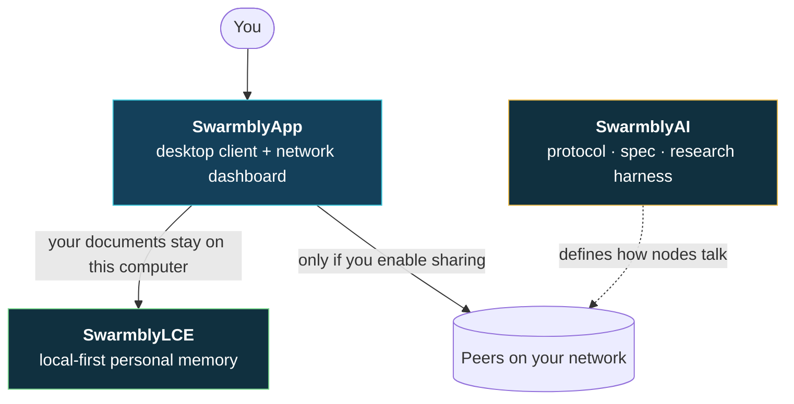
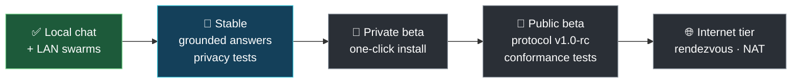
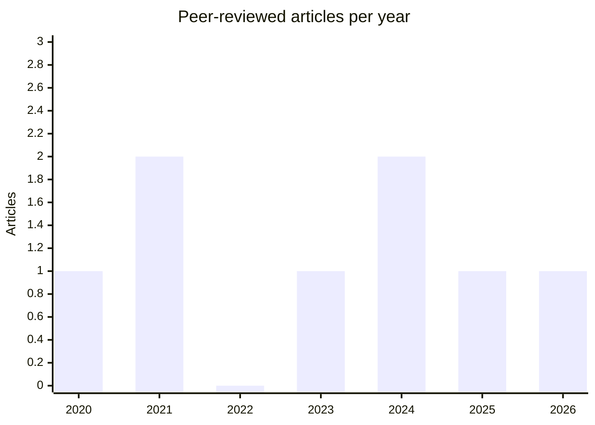
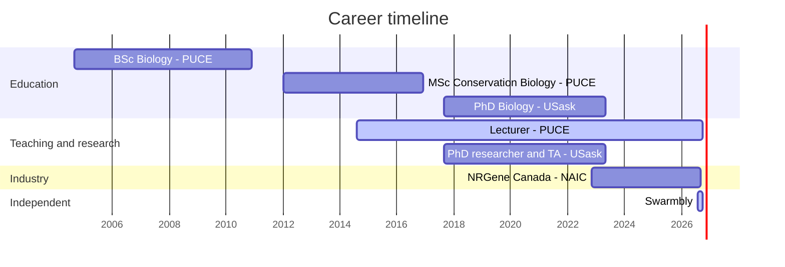

🌐 **English** · 🇪🇸 [Leer en español](README.es.md)

    

## Hi, I'm Seb 👋

I'm a **biologist and genomics specialist** (PhD, University of Saskatchewan) based in Canada. I spent 18+ years reading genomes — from Galápagos mockingbirds to black soldier flies — and now I borrow what genomics taught me to build a different kind of AI: one that **splits the problem, not the model**.

| Snapshot | Details |
| --- | --- |
| 🧬 What I do | Population & conservation genomics · selective breeding · bioinformatics |
| 🤖 What I'm building | [**Swarmbly**](#swarmbly) — decentralized small-model inference inspired by genome assembly |
| 🎓 Teaching | Lecturer (Adjunct Professor), PUCE — since 2014 |
| 🧪 Recently | R&D Manager & Principal Investigator, NRGene Canada's North American Insect Center (until Sep 2026) |
| 🗣️ Languages | Spanish (native) · English (full professional) |
| 📍 Based in | Canada |

**Find your way around**

| If you are… | Start here | You'll find |
| --- | --- | --- |
| 🔬 A researcher | [Science](#science) · [Swarmbly](#swarmbly) | 8 papers, preprints and DOIs |
| 💻 A developer | [Swarmbly](#swarmbly) · [Innovations](#innovations) | Swarmbly repos (AGPL-3.0), research tools, honest status |
| 🧭 A recruiter or collaborator | [Experience](#experience) · [Toolbox](#toolbox) | Career timeline, skills, leadership |
| ☕ A supporter | [Support](#support) | What your support pays for |

> [!IMPORTANT]
> **Swarmbly is alpha research software.** Its papers are preprints and have **not** been peer reviewed. I publish what works *and* what doesn't — the negative results are in the open.

## Swarmbly

**Fragment the *problem*, not the *model*.**

Most decentralized AI cuts a **model** across machines, so everything waits for the slowest one. Swarmbly cuts the **request**: a small local model splits a structured task into micro-tasks, ordinary computers answer them in parallel with small models, and the answers are reassembled on your own machine — the way a genome is assembled from sequencing reads.

| Step | What happens | Why it matters |
| --- | --- | --- |
| ① Fragment | A small local model splits the request into self-contained micro-tasks (only when the task has a real structure; free prose stays local) | No single machine needs a big model |
| ② Dispatch | Micro-tasks go out **in parallel** to authenticated computers on your network | A slow node doesn't block the rest |
| ③ Replicate | Replicas are sent to *different model families* and checked (signatures, schema) | Redundancy against bad or missing answers |
| ④ Assemble | Your machine aligns the replies, votes by consensus and splices the final answer | Your documents and the full request never have to leave |

🧬 <b>Click to open:</b> how genome assembly maps onto Swarmbly

| Shotgun genome assembly | Swarmbly | Idea |
| --- | --- | --- |
| Reads | Micro-prompts | Short pieces that are solved independently |
| Coverage | Replication across *k* model families | Several independent looks at the same piece |
| Overlap | Seams between fragments | Shared edges tell you how pieces fit |
| Consensus | Multiple-alignment vote | Disagreements are resolved by majority, not by hope |
| Contigs → scaffold | Spliced, final answer | Pieces become one coherent whole |

### How the three repos fit together

| Repo | What it is | Status | Cite |
| --- | --- | --- | --- |
| [**SwarmblyAI**](https://github.com/Sebastardito/SwarmblyAI) | Protocol, specification and measurement harness (Python, AGPL-3.0-or-later) | Research code · defensive publication | [10.5281/zenodo.21956743](https://doi.org/10.5281/zenodo.21956743) |
| [**SwarmblyLCE**](https://github.com/Sebastardito/SwarmblyLCE) | Local Cognitive Extension: personal memory that stays on your machine (draft spec, 109 tests, CLI) | Draft · not peer reviewed | [10.5281/zenodo.23289041](https://doi.org/10.5281/zenodo.23289041) |
| [**SwarmblyApp**](https://github.com/Sebastardito/SwarmblyApp) | Desktop client and network dashboard: local chat, LAN swarms, “Explore processing” | Alpha | [10.5281/zenodo.23322639](https://doi.org/10.5281/zenodo.23322639) |

📄 Whitepaper: [*Semantic Fragmentation and Stochastic Assembly*](https://doi.org/10.5281/zenodo.23031305) (v2, EN/ES, CC BY 4.0) · LCE whitepaper: [10.5281/zenodo.23150478](https://doi.org/10.5281/zenodo.23150478)

### Honest status

| ✅ Works today | 🚧 Not yet |
| --- | --- |
| Local chat with Ollama or any OpenAI-compatible server | Swarms over the internet (rendezvous, NAT) |
| Computers on the same network find each other without typing addresses (mDNS) | Full verification of results (partial today) |
| Signed node identities (Ed25519) bound to TLS 1.3 | Calibrated thresholds for seams and consensus |
| Structured requests fragmented and dispatched in parallel | Large-scale measurements with real models |
| Multi-model consensus — reported as *agreement*, never as proof of accuracy | Peer review |
| “Explore processing”: every answer shows its 14 pipeline stages; each number is labelled *measured*, *estimated* or *unknown* | Fragmenting free prose (it is answered locally, by design) |

### Results so far — including the negative ones

| Question | What I found | Where |
| --- | --- | --- |
| Does fragmenting and reassembling a prompt cost quality? | Mixed: better than a single pass in some task categories, with a measurable coherence cost. I don't claim it is faster than centralized APIs. | SwarmblyAI |
| Does agreement between replicas predict quality? | No measurable relation → **I demoted that part of the design.** | SwarmblyAI |
| Does local memory help answers about my own documents? | Yes: +0.500 (exploratory). | SwarmblyLCE |
| Does a digested wiki beat plain retrieval over the sources? | No: −0.146 (confirmatory) → the wiki is now a governance layer, not the answering memory. | SwarmblyLCE |

🗺️ <b>Click to open:</b> where Swarmbly is heading (milestones, no dates)

Milestones are goals, not promises; each one has to pass measurements that I define *before* running them.

## Innovations

A quick tour of what is new in my work, from the lab bench to the swarm.

| Innovation | What's new about it | Where to see it |
| --- | --- | --- |
| 🧩 Problem-fragmentation inference | Splits the *request* instead of the model, borrowing shotgun-assembly logic from genomics | [SwarmblyAI](https://github.com/Sebastardito/SwarmblyAI) |
| 🧠 Local-first cognitive extension | Personal memory with verifiable forgetting; the wiki is a governance layer, retrieval runs over your own sources | [SwarmblyLCE](https://github.com/Sebastardito/SwarmblyLCE) |
| 🔍 Answers that show their work | “Explore processing”: 14 stages, every attempt and the node that served it, with *measured / estimated / unknown* labels | [SwarmblyApp](https://github.com/Sebastardito/SwarmblyApp) |
| 📏 Falsifiable AI research | Pre-registered experiments, explicit abandonment criteria, and negative results published next to the positive ones | [Results](#results-so-far--including-the-negative-ones) |
| 🪰 Breeding technology | Phenotyping apps (LarvaeTracker, Image Analyzer) and genotype–phenotype/GWAS tools that cut time on key tasks by up to 80% | [LarvaeTracker](https://github.com/Sebastardito/LarvaeTracker) · [Experience](#experience) |
| 🍎 On-device LLMs | 20+ custom LLMs fine-tuned with Unsloth and MLX, optimized for inference on Apple Silicon | [Toolbox](#toolbox) |

### More open-source tools

Smaller projects from the lab and the field, all public on my GitHub.

| Repo | What it does | Stack |
| --- | --- | --- |
| [**LarvaeTracker**](https://github.com/Sebastardito/LarvaeTracker) | Web app that turns raw growth data into interactive growth curves, multi-level statistics (ANOVA + Tukey HSD, Pearson/Spearman, hierarchical clustering, trend detection) and one-click PDF reports | Python · Flask |
| [**Seb-CamControl**](https://github.com/Sebastardito/Seb-CamControl) | Browser-based control of USB and built-in cameras: photos, video and time-lapse, with live filter previews (bilingual README) | Python · Flask · OpenCV |
| [**Phenotools**](https://github.com/Sebastardito/Phenotools) | Small scripts for phenotype and growth-data analysis (Growth Tracker) | Python |

🔒 <b>Click to open:</b> also in my workshop — private projects, described by concept

Some of what I build lives in private repositories (lab-related work or projects still in development). Here is what they cover, without the code:

| Concept | What it covers | Skills it shows |
| --- | --- | --- |
| 📊 Growth & morphology analytics platform | A general, domain-agnostic version of the growth-analysis dashboard: standardized metrics, interactive plots and automated reports for any developmental or morphological dataset | Statistical modelling, Flask, data visualization, reproducible reporting |
| 📷 Computer vision for size and shape | Image-based measurement with fiducial (ArUco) markers, shape-model generation and size/weight prediction from photos | OpenCV, calibration, predictive models, image analysis |
| 🌡️ Embedded environment control | Microcontroller firmware for air and environment control, with gas-sensor arrays and their calibration, for rearing and lab automation | ESP32, C/C++, sensors, hardware–software integration |
| 🎥 Camera & time-lapse control | A lightweight web app to control USB and built-in cameras remotely: live focus, exposure, brightness and zoom, plus photo, video and time-lapse capture | Web UIs, video streaming, concurrency |
| 🧬 Reproducible genomics workflows | Analysis scripts from my PhD (demographic inference with G-PhoCS, custom plots in R and Python) and supporting data for a published paper | Population genomics, R, Python, open data |

## Science

Eight peer-reviewed articles in population genomics, molecular ecology and conservation — and a PhD on Galápagos mockingbirds.

| Year |  | Paper | Journal | My role |
| --- | --- | --- | --- | --- |
| 2026 | 🦭 | [Complete mitogenomes of the endangered Galápagos fur seal](https://doi.org/10.1007/s10709-026-00264-9) | Genetica 154:13 | 4th author |
| 2025 | 🐦 | [Genomes of Galápagos mockingbirds reveal the impact of island size and past demography on inbreeding and genetic load](https://doi.org/10.1111/mec.17665) | Molecular Ecology 34(5):e17665 | 2nd author |
| 2024 | 🦗 | [Patterns of genomic heterogeneity in a classic field cricket mosaic hybrid zone](https://doi.org/10.1002/ece3.70643) | Ecology and Evolution | 3rd author |
| 2024 | 🐦 | [Whole-genome analysis reveals the diversification of the Galápagos rail and confirms the success of goat eradication](https://doi.org/10.1093/jhered/esae017) | Journal of Heredity esae017 | 3rd author |
| 2023 | 🦭 | [Time-calibrated phylogeny and full mitogenome of the Galápagos sea lion from scat DNA](https://doi.org/10.7717/peerj.16047) | PeerJ 11:e16047 | 4th author |
| 2021 | 🌴 | [Relieving efforts in palm-tree tissue sampling for population genetics analyses](https://doi.org/10.1002/ece3.7624) | Ecology and Evolution 11:7946 | **Sole author** |
| 2021 | 🐣 | [Epigenetic effects of parasites and pesticides on captive and wild nestling birds](https://doi.org/10.1002/ece3.7606) | Ecology and Evolution 11(12):7713 | 3rd author |
| 2020 | 🐦 | [Evolutionary history of the Galápagos rail revealed by ancient mitogenomes and modern samples](https://doi.org/10.3390/d12110425) | Diversity 12:425 | 4th author |

🎓 **PhD thesis (2023):** *Population Genomics of the Galapagos Island Mockingbirds and Implications for Conservation* — University of Saskatchewan.

**Preprints & open-source software**

| Year | Work | Link |
| --- | --- | --- |
| 2026 | *Semantic Fragmentation and Stochastic Assembly: A Protocol for Decentralized Language-Model Inference over Untrusted Volunteer Nodes* (Swarmbly) — preprint, EN/ES | [10.5281/zenodo.21957088](https://doi.org/10.5281/zenodo.21957088) · v2: [23031305](https://doi.org/10.5281/zenodo.23031305) |
| 2026 | *Local Cognition and Anchored Transmission: A Local-First Cognitive Extension for Swarmbly* — draft | [10.5281/zenodo.23150478](https://doi.org/10.5281/zenodo.23150478) |
| 2026 | Swarmbly AI · SwarmblyLCE · SwarmblyApp — software records | [AI](https://doi.org/10.5281/zenodo.21956743) · [LCE](https://doi.org/10.5281/zenodo.23289041) · [App](https://doi.org/10.5281/zenodo.23322639) |

🔗 All publications: [Google Scholar](https://scholar.google.com/citations?user=9z5Q13QAAAAJ) · [ORCID](https://orcid.org/0000-0003-1497-356X) · [ResearchGate](https://www.researchgate.net/profile/Sebastian-Espinoza-Ulloa)

## Experience

| When | Role | Where | Highlights |
| --- | --- | --- | --- |
| 2024–2026 | **R&D Manager** | NRGene Canada · North American Insect Center (Saskatoon) | Led black soldier fly phenotyping, selective breeding and genomics with a team of 8–12; 15–30 breeding lines over ~24 generations; automation that cut time on key tasks by up to 80%; varieties that could roughly double the weight of commercial ones |
| 2023–2024 | Head Entomologist & Principal Investigator | NRGene Canada | Built the lab rearing, phenotyping and breeding operation from the ground up; SOPs; WGS-driven breeding strategies |
| 2022–2023 | Research Technician | NRGene Canada | Rearing protocols, phenotypic data collection, tissue preparation |
| 2014–today | **Lecturer (Adjunct Professor)** | PUCE, Ecuador — Health Sciences & Psychology | Biochemistry, Introduction to Biology, molecular techniques for diagnosis, research methodology — 12+ years |
| 2017–2023 | PhD researcher & Teaching Assistant | University of Saskatchewan (Saskatoon) | Galápagos mockingbird population genomics; fieldwork, NGS library prep, variant calling, de novo assembly, annotation |
| 2007–2017 | Researcher & laboratory roles | PUCE · SENECYT · Ministry of Environment of Ecuador | Molecular ecology, genetic inventories of Andean fauna, a genetic characterization of Ecuador's national parks (8,000+ sequences) |

| Degree | Institution | Thesis |
| --- | --- | --- |
| **PhD, Biology** (2017–2023) | University of Saskatchewan, Saskatoon, Canada | Population genomics of the Galápagos Island mockingbirds and implications for conservation |
| **MSc, Conservation Biology** (2012–2016) | PUCE, Ecuador | Edge effect on the demographics and genetic structure of *Prestoea acuminata* palm populations |
| **BSc, Biology** (2004–2010) | PUCE, Ecuador | Historical and spatial variation in genetic structure of two *Ceroxylon echinulatum* populations |

🦋 <b>Click to open:</b> beyond the lab

- Directed a **commercial and tourism butterfly farm** at an Ecuadorian ecolodge (2009–2012): breeding protocols and ecological management.
- **Certified martial-arts instructor** (kickboxing, Muay Thai, self-defense), 1999–2017 — teaching all ages long before the lecture hall.
- Worked in **photography, film and TV production** (2000–2003) before switching to biology.

## Toolbox

               

<b>🧬 Genomics & bioinformatics</b>

`HISAT2` · `BWA-MEM` · `Bowtie2` · `STAR` · `GATK` · `SAMtools` · `bcftools` · `Picard` · `snpEff` · `Trimmomatic` · `vcftools` · `PLINK` · `ADMIXTURE` · `BLAST` · `Trinity` · `G-PhoCS` · `DESeq2` / `edgeR` · `GBLUP` / `rrBLUP` — WGS, RNA-seq, GWAS, demographic inference, de novo assembly and annotation on HPC

<b>🤖 AI & software</b>

LLM fine-tuning (`Unsloth`, `MLX`, `PyTorch`) · on-device inference · evaluation design · Python/Flask web apps for phenotype and growth-data analysis · computer vision (`OpenCV`, fiducial markers) · imaging automation (camera control, time-lapse) · embedded firmware (`ESP32`, C/C++) · SQLite · FastAPI local services

<b>🧪 Wet lab</b>

DNA/RNA purification · NGS library preparation · PCR · microsatellites · field and museum sampling · tissue handling

<b>👥 Leadership & teaching</b>

R&D portfolio and project management · SOP authoring · quality control and regulatory compliance · mentoring technicians and scientists · curriculum design · Agile/Scrum with Jira

## Support

Swarmbly is **independent, open source (AGPL-3.0) and not funded by any institution**. Support pays for the first real-world tests — physical computers and a rendezvous server — and for the time to publish the results, including the negative ones. It doesn't buy tokens, shares or promised features.

| Way to help | How | Cost |
| --- | --- | --- |
| ⭐ Star | Star a repo so others can find it | Free |
| 🧪 Try it | Run [SwarmblyApp](https://github.com/Sebastardito/SwarmblyApp) and [open an issue](https://github.com/Sebastardito/SwarmblyApp/issues) with what broke or confused you | Free |
| 📚 Cite | Use the DOIs above if the work informs yours | Free |
| ☕ Support | A coffee funds hardware, hosting and measurement time | Your call |

## Contact

| Where | Link |
| --- | --- |
| 📧 Email | [sebas_saeu@hotmail.com](mailto:sebas_saeu@hotmail.com) |
| 💼 LinkedIn | [sebastian-espinoza-ulloa](https://www.linkedin.com/in/sebastian-espinoza-ulloa-781a4bb8/) |
| 🆔 ORCID | [0000-0003-1497-356X](https://orcid.org/0000-0003-1497-356X) |
| 🎓 Google Scholar | [Profile](https://scholar.google.com/citations?user=9z5Q13QAAAAJ) |
| 🔬 ResearchGate | [Sebastian-Espinoza-Ulloa](https://www.researchgate.net/profile/Sebastian-Espinoza-Ulloa) |
| 💻 GitHub | [@Sebastardito](https://github.com/Sebastardito) |
| ☕ Buy Me a Coffee | [buymeacoffee.com/swarmbly](https://buymeacoffee.com/swarmbly) |

Thanks for stopping by. If anything here is unclear, write to me — explaining things well is part of the work. 🧬

